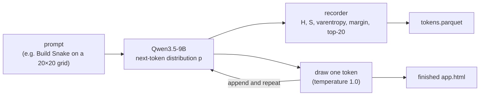
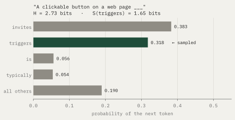
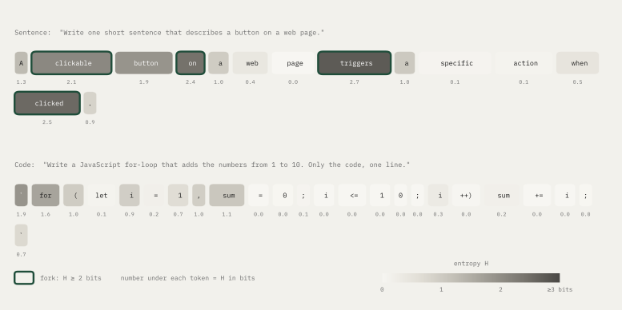
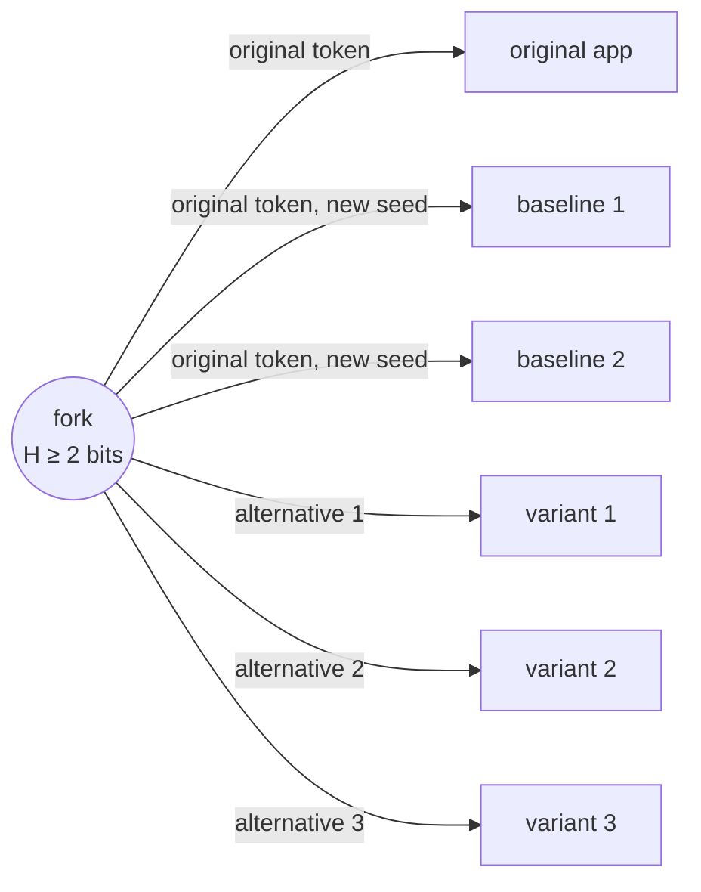
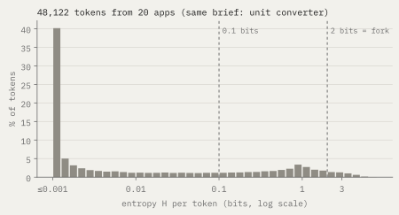
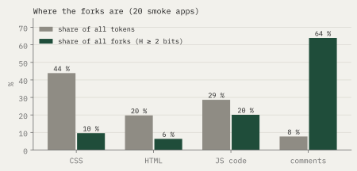

# Entropy Trail

Entropy Trail is a basic-research study of how decisions emerge inside a language model while it builds something. A local model (Qwen3.5-9B, bf16, MLX) writes small single-file HTML apps, and for every generated token we record the entropy of the next-token distribution, the surprisal of the sampled token, varentropy, the top-1/top-2 margin and the top-20 candidates. We ask whether the way the probability landscape reshapes shows a pattern during construction, and whether entropy (or a related quantity) indicates that an output is useful or novel.

Full design: [docs/superpowers/specs/2026-11-19-entropytrail-design.md](docs/superpowers/specs/2026-11-19-entropytrail-design.md)

## The method

### 1. Let the model write, and record every step

A language model writes one token at a time. At every step it holds a probability distribution over its whole vocabulary (248,320 tokens for Qwen3.5-9B): the *landscape* of what could come next. The model draws one token from it, the token becomes part of the text, and the landscape for the next step is reshaped. We do not change how the model writes (temperature 1.0, no truncation of the distribution); we only record the landscape at every step.



### 2. Two numbers per token

For the distribution p at position t and the token x_t that was actually drawn:

- **Entropy** H_t = −Σ p(v) log₂ p(v), summed over all tokens v of the vocabulary. *How open was this position?* 0 bits means the model had no choice; 1 bit is like a fair coin; 3 bits is like eight equally likely options.
- **Surprisal** S_t = −log₂ p(x_t). *How unexpected was the token that was actually drawn?*

A position with H ≥ 2 bits is called a **fork**: the model could have gone several ways there.

**Worked example.** We asked the model for one sentence about a button on a web page (a plain-text example, outside the study grid). After *"A clickable button on a web page"* it saw this distribution:



| candidate | p | −log₂ p | −p log₂ p |
|---|---|---|---|
| invites | 0.383 | 1.39 | 0.530 |
| **triggers** (drawn) | 0.318 | **1.65** | 0.526 |
| is | 0.056 | 4.16 | 0.233 |
| typically | 0.054 | 4.21 | 0.227 |
| about 248,000 others | 0.190 together | | 1.216 together |
| **sum** | 1.000 | | **H = 2.73 bits** |

So this position is a fork (H = 2.73 bits), and the token that was drawn, *triggers*, had a surprisal of 1.65 bits. Had the model drawn *invites*, the sentence would have gone on to describe an invitation to click rather than an action: a different sentence from that point on.

### 3. A whole text as a trail

Colouring every token by its entropy shows where the decisions sit. Both examples are real recordings (Qwen3.5-9B, seed 7):



- In the **sentence**, the open positions are content words: *clickable*, *on*, *triggers*, *clicked*. Once *triggers* is drawn, only *a* or *an* is still open (1.0 bit); *specific action* then follows almost by itself (0.1 bits each).
- In the **code**, the line is decided in its first few tokens. At the comma in `for (let i = 1,` the model would have preferred a semicolon (p = 0.63). Drawing the comma (S = 1.43 bits) commits the loop to declaring a second variable in its header. Only its name is still open (`sum` or `s`, 1.1 bits); the rest of the line, `= 0; i <= 10; i++) sum += i;`, carries almost no entropy.

Adding up the surprisal along the trail gives the **path action** Σ S_t, the negative log-probability of the whole text: 12.6 bits for the sentence (a 1-in-6,000 path) and 8.4 bits for the line of code (1 in 340). This is the path-integral view: the finished text is one path among all the paths the model could have taken, and each path has a weight.

### 4. Many runs, and going back to the forks

One recording shows where the model *was* undecided. Two further steps show what was *reachable*:

- **Ensembles.** Every prompt is run 20 times with different seeds. The spread of the 20 finished apps shows how wide the landscape is for that prompt.
- **Fork experiments.** At selected forks we rewind, force each of the top-3 alternative tokens, and let the model finish the app from there. As a baseline, the same fork is re-run twice with the original token, because sampling alone makes runs drift apart. A fork *matters* if the alternatives lead further away than the baseline does.



Fork importance = (distance from the variants to the original) − (distance from the baselines to the original), measured on screenshots of the rendered apps.

### 5. Judging the outcome independently

Every app is rendered in a headless browser: does it load, are there console errors, what does it look like. Novelty is measured as the distance of an app to its 19 siblings. Usefulness and novelty are also rated by people on a public, blind rating page. The analysis then asks whether the landscape measures from steps 2–4 predict these independent judgments. The tests are fixed in advance in [docs/METHODS.md](docs/METHODS.md) (analysis plan, frozen 2026-11-20).

## Study design

| | Tight brief | Loose brief |
|---|---|---|
| Education | fractions quiz · times-table trainer · Pythagoras with sliders | understand fractions · solar system · practise for a test |
| Game | Snake · memory · Breakout | game for a break · one-key game · puzzle game |
| Tool | unit converter · Pomodoro timer · tip calculator | everyday helper · planning tool · repetitive task |
| Free | *app of your choice* · *app nobody has built before* · *app you would enjoy building* | |

21 prompts × 20 samples = 420 apps, generated at night on a Mac Studio (M2 Max, 32 GB). The exact prompts are in [prompts/prompts.yaml](prompts/prompts.yaml); the hypotheses H1–H6 are in section 6 of the [design](docs/superpowers/specs/2026-11-19-entropytrail-design.md).

## First observations (exploratory)

Before the main grid, the model built the same tight brief (a cm/inch/feet converter) 20 times. These are early numbers from one prompt, not tests of the hypotheses.



Most tokens are close to certain (72 % below 0.1 bits), a second, smaller group sits around 1 bit, and 4.5 % are forks.



Most forks are not in the code: comments are 8 % of the tokens but hold 64 % of the forks, because how to word a comment is far more open than what the code must say. The analysis plan was therefore amended before the main grid: forks are counted in code only, and comment forks are reported separately (D-029 in [docs/DECISIONS.md](docs/DECISIONS.md)).

The figures are generated from the small data files in `docs/figures/data/` with `uv run --with matplotlib python scripts/make_readme_figures.py`.

## Setup

```
uv sync
```

Python 3.12 is provided by uv; `mlx-lm` is pinned to 0.32.2. The model weights are read from the Hugging Face cache (`HF_HOME`).

## Raw data

Raw data lives outside the repo in `/Volumes/Data/entropytrail/` (override with the environment variable `ENTROPYTRAIL_DATA`), laid out as `<condition_id>/<prompt_id>/<sample:03d>/` with `output.txt` (raw model output), `app.html` (extracted app, if any), `tokens.parquet` and `meta.json`. Each condition directory also holds `condition.json` (condition manifest, checked on every run); the data root holds `runlog.jsonl`, `_validation/` and `_bench/`. See [docs/DATA.md](docs/DATA.md).

## How to run

```
C=configs/conditions/qwen35-9b-bf16-mlx.yaml; P=prompts/prompts-v0-smoke.yaml  # main grid: prompts/prompts.yaml
uv run et generate   --condition $C --prompts $P --prompt-id smoke-tool-01 --sample 0
uv run et run-window --condition $C --prompts $P --samples 20 --until 06:00 [--prompt-ids ID ...]
uv run et validate   --condition $C --prompts $P --tokens 1500    # recorder validation (D-021)
uv run et bench      --condition $C --tokens 1000                 # single-sequence throughput
```

`generate` and `run-window` skip units that are already done and refuse to run on a git working tree with uncommitted changes unless `--allow-dirty` is given. Stop Ollama (or make sure it holds no model) before running the 9B model. The nightly schedule on the Studio is described in [ops/README.md](ops/README.md).

## Tests

```
uv run pytest              # fast tests
uv run pytest -m slow      # tests that need the Qwen3.5-9B weights
```

## Documentation

- [docs/DECISIONS.md](docs/DECISIONS.md): decision log
- [docs/METHODS.md](docs/METHODS.md): definitions of the recorded quantities
- [docs/THEORY.md](docs/THEORY.md): reading frame — generation as a process on a tree, apps as its projection
- [docs/DATA.md](docs/DATA.md): data formats
- [docs/JOURNAL.md](docs/JOURNAL.md): dated project journal
